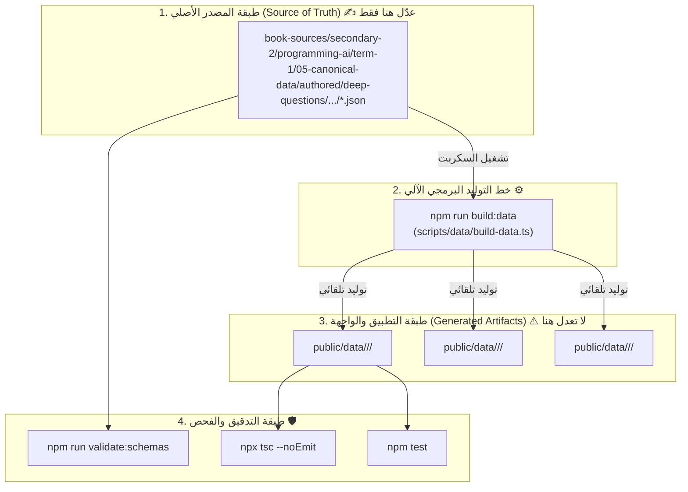

# 📖 دليل إدارة وتعديل المحتوى والأسئلة وأوامر البناء
# 🛠️ Curriculum Data Authoring & Build Workflow Guide

دليل عملي وتطبيقي يوضح دورة حياة البيانات في المنظومة، وطريقة تعديل وإضافة الأسئلة بالشكل الصحيح، مع قائمة كاملة بالأوامر المستخدمة للتحقق والبناء.

---

## 🏛️ 1. المفهوم المعماري: مصدر الحقيقة مقابل نتاج التطبيق

تعتمد المنظومة على مبدأ **المصدر الوحيد للحقيقة (Single Source of Truth - SSOT)** لضمان الدقة وتفادي التعارض:



### المقارنة بين المجلدين:
| الخاصية | مجلد المصادر `book-sources/` | مجلد التطبيق `public/data/` |
| :--- | :--- | :--- |
| **طبيعة الملفات** | ملفات `JSON` خام معيارية | ملفات `JSON` مُولّدة برمجياً |
| **القابلية للتعديل** | ✅ **يتم التعديل هنا فقط** | ❌ **ممنوع التعديل اليدوي** (تُستبدل تلقائياً) |
| **الدور** | تخزين المحتوى، مراجعة وتدقيق المنهج | البيانات التي تقرؤها الواجهة أثناء التشغيل |

---

## 🚀 2. خطوات تعديل أو إضافة الأسئلة (Workflow)

لإضافة أسئلة جديدة أو تصحيح أسئلة حالية، اتبع الخطوات الثلاث التالية:

### الخطوة 1: افتح ملف الـ JSON المصدري المخصص للدرس
المسار:
```text
book-sources/secondary-2/programming-ai/term-1/05-canonical-data/authored/deep-questions/chapter-[X]/lesson-[X]-[Y].json
```
*مثال:* للدرس الثاني من الفصل الأول:
`book-sources/secondary-2/programming-ai/term-1/05-canonical-data/authored/deep-questions/chapter-1/lesson-1-2.json`

---

### الخطوة 2: عدّل أو أضف السؤال وفق البنية القياسية

يجب أن يلتزم كل سؤال بالهيكل التالي بدقة:

```json
{
  "id": "q-hard-1-2-01",
  "lessonId": "lesson-1-2",
  "lessonNumber": "1-2",
  "index": 1,
  "type": "mcq",
  "title": "عنوان مختصر يعبر عن الجزئية العلمية",
  "cognitiveLevel": "تمييز بين المفاهيم",
  "difficulty": "medium",
  "conceptIds": [
    "concept-1-2-01"
  ],
  "contentOrigin": "authored",
  "question": "نص السؤال بوضوح وصياغة لغوية سليمة؟",
  "options": [
    "الخيار الأول (0)",
    "الخيار الثاني (1)",
    "الخيار الثالث (2)",
    "الخيار الرابع (3)"
  ],
  "correctAnswer": 1,
  "correctAnswerText": "الخيار الثاني (1)",
  "misconceptionTrap": "شرح الفخ المفاهيمي ولماذا قد يخطئ الطالب",
  "depthExplanation": "التفسير والعمق العلمي المعتمد المستند لنص الكتاب",
  "teacherDiscussionPrompt": "إرشاد ونقاش مقترح للمعلم داخل الفصل",
  "trapType": "concept_confusion",
  "isExamLikely": true,
  "source": {
    "term": 1,
    "lessonId": "lesson-1-2",
    "pages": [12, 13],
    "primaryPage": 12,
    "sourceType": "official-page-scan"
  },
  "contentProvenance": {
    "question": "derived-from-curriculum",
    "explanation": "pedagogical-explanation",
    "teacherPrompt": "pedagogical-extension"
  },
  "validation": {
    "distractorsPlausible": true,
    "noExternalKnowledge": true,
    "noDuplicate": true,
    "conceptAligned": true,
    "noAnswerLeakage": true,
    "optionsIndependent": true
  }
}
```

---

### الخطوة 3: توليد ملفات التطبيق البرمجية تلقائياً
بعد حفظ التعديل في ملف الـ JSON، شغّل هذا الأمر في الطرفية (Terminal):
```bash
npm run build:data
```
> **ماذا يفعل هذا الأمر؟**
> يقرأ تلقائياً كافة ملفات الـ JSON في `book-sources/` ويقوم بتوليد وتحديث كافة ملفات `public/data/` المقابلة، وتحديث ملفات الفهارس والتصدير دون أي تدخل يدوي منك.

---

### الخطوة 4: التحقق والتدقيق (Quality Assurance)
تأكد من عدم وجود أي خطأ في الأنواع أو المخططات بتشغيل:
```bash
npm run validate:schemas
npx tsc --noEmit
```

---

## ✏️ 3. تعديل نص شرح الدرس"
//==============================
لخطوات (ترم أول)
1. افتح صورة الصفحة في 02-page-scans/page_NN.png واعرف الصح إيه.

2. عدّل في book.json، الملف اللي فاتحه دلوقتي:

ادخل على chapters ← الفصل ← lessons ← الدرس.
عدّل النص، أو غيّر ترتيب العناصر جوه القايمة. مثلًا انقل قسم كامل جوه sections بالـ { } بتاعته.
3. عدّل نفس الحاجة في الملف التاني:


05-canonical-data/official/official-lessons/chapter-N/lesson-X-Y.json
دوّر على الكتلة اللي ليها نفس sectionId أو conceptId أو title، وخلّي النص في text مطابق بالظبط للي كتبته في book.json. ولو غيّرت الترتيب، رتّب الكتل هنا بنفس الترتيب عشان النسختين يفضلوا شبه بعض.

4. شغّل:


npm run build:data
npm run audit:canonical
لو ظهر ❌ يبقى في فرق بين الملفين، صلّحه.

5. شوف النتيجة في الموقع على السيرفر اللي إنت مشغّله على localhost:3000.

⚠️ متشغّلش generate-book-json ولا generate-official-curriculum على الترم الأول، لأنهم هيكتبوا فوق تعديلاتك.
//======================================
نص الشرح (أهداف التعلم، الفكرة الرئيسية، المفاهيم، أقسام الشرح، الصناديق الجانبية، الأمثلة، الملخص) **نص رسمي منقول من كتاب الوزارة**، وليس مثل أسئلة الفهم المؤلَّفة؛ لذلك له مسار مختلف وقواعد أشد.

> ⚠️ **القاعدة الأساسية:** النص الرسمي يطابق الكتاب حرفًا بحرف. التعديل المسموح هو تصحيح خطأ في النقل ليعود النص كما هو في صفحة الكتاب، لا إعادة الصياغة ولا الإضافة ولا الحذف. راجع صورة الصفحة في `02-page-scans/page_NN.png` قبل أي تعديل. وأي شرح إضافي من خارج الكتاب يجب أن يظهر في الواجهة معلَّمًا بـ «💡 توضيح إضافي».

### أين يوجد النص؟
المسارات التالية داخل مجلد الترم، مثل `book-sources/secondary-2/programming-ai/term-2/`:

| الملف | دوره |
| :--- | :--- |
| `05-canonical-data/official/book.json` | النص الذي يعرضه الموقع؛ يبني منه `npm run build:data` ملفات `public/data/.../lessons/` |
| `05-canonical-data/official/official-lessons/chapter-N/lesson-X-Y.json` | نسخة مرجعية من النص في صورة كتل (`officialBlocks`)؛ يقارنها `npm run audit:canonical` بملف `book.json` ويوقف البناء عند أي اختلاف بينهما |
| `06-build-modules/chapterN.mjs` | مصدر الملفين السابقين في الترم الثاني فقط |

### أ) الترم الثاني (`term-2`) — الفصول 5 إلى 7

**الخطوة 1:** عدّل النص في ملف الفصل:
```text
book-sources/secondary-2/programming-ai/term-2/06-build-modules/chapterN.mjs
```
*مثال:* الفصل الخامس في `chapter5.mjs`. لا تعدّل `book.json` ولا `official-lessons/` يدويًا، فالخطوة التالية تكتب فوقهما.

**الخطوة 2:** ولّد الملفين ثم ملفات التطبيق:
```bash
node scripts/generate-book-json.mjs --part term-2
node scripts/generate-official-curriculum.mjs --part term-2
npm run build:data
```
> للتحقق من فصل واحد دون كتابة أي ملف: `node scripts/generate-book-json.mjs --part term-2 --chapter 5`

**الخطوة 3:** شغّل فحوص المطابقة:
```bash
npm run audit:canonical     # تطابق book.json مع official-lessons/
npm run audit:source-text   # تطابق النص كلمة بكلمة مع نص ملف الـ PDF
```
`audit:source-text` يقارن كل نص رسمي بنص الـ PDF في `03-raw-extractions/`. إذا فشل فالأصل أن النص المنقول مختلف عن الكتاب، فصحّحه. لا يُضاف عنصر إلى `03-raw-extractions/04-verified-exceptions.json` إلا إذا كان العيب في نص ملف الـ PDF نفسه (مثل كلمة إنجليزية مقلوبة، أو سطر من العمود الجانبي ملتصق بسطر من العمود الرئيسي، أو نص مرسوم داخل صورة)، وبعد مراجعة الصفحة المطبوعة وكتابة السبب.

### ب) الترم الأول (`term-1`) — الفصول 1 إلى 4

بيانات الترم الأول الرسمية **مُحرَّرة يدويًا**، وسكربتا التوليد السابقان يرفضان العمل عليه. لا تستخدم معهما `--force-legacy`، لأنهما سيعيدان كتابة `book.json` و`official-lessons/` من `06-build-modules/` فتضيع التعديلات اليدوية. عدّل الملفين يدويًا:

**الخطوة 1:** في `05-canonical-data/official/book.json` افتح الدرس المطلوب (`chapters[].lessons[]`) وعدّل الحقل المناسب، مثل:
- `sections[].content` لأقسام الشرح
- `keyConcepts[]` للمفاهيم
- `callouts[]` للصناديق الجانبية
- `learningObjectives` و`coreIdea` و`keyQuestion` و`summary`

**الخطوة 2:** عدّل النص نفسه في الحقل `text` للكتلة المقابلة في `official-lessons/chapter-N/lesson-X-Y.json`. نوع الكتلة في `type` (`section`، `concept`، `callout`، `objective`، `summary`…)، وتُعرف الكتلة المقابلة من `sectionId` أو `conceptId` أو `calloutId` أو من `title`.

**الخطوة 3:** ولّد ملفات التطبيق وتحقق:
```bash
npm run build:data
npm run audit:canonical
```
> `audit:source-text` يتخطى الترم الأول، فالمرجع الوحيد للتأكد من مطابقة الكتاب هو صورة الصفحة في `02-page-scans/`.

---

## 🎯 4. القيم والأنواع المسموحة للأسئلة (Validation Rules)

لتفادي أي أخطاء في الـ TypeScript أو أدوات التدقيق:

### أ) مستويات الصعوبة (`difficulty`)
المستويات المعتمدة:
1. `"easy"` (سهل)
2. `"medium"` (متوسط)
3. `"hard"` (صعب)
4. `"very-hard"` (صعب جداً)
5. `"expert"` (مستوى خبير)

### ب) المستويات المعرفية المعتمدة (`cognitiveLevel`)
يجب اختيار القيمة من القائمة المعيارية المعتمدة:
- `"فهم مباشر عميق"`
- `"فهم وتعريف"`
- `"تمييز بين المفاهيم"`
- `"تطبيق على موقف"`
- `"تطبيق سيناريو"`
- `"تحليل ومقارنة"`
- `"تحليل واستنتاج"`
- `"تحليل وربط"`
- `"تقييم واتخاذ قرار"`
- `"تقييم"`
- `"تطبيق مركب"`
- `"تركيب"`
- `"تركيب وتقييم"`
- `"استكشاف أخطاء ونمذجة"`
- `"اكتشاف خطأ وتريكات"`
- `"كشف مفهوم خاطئ"`
- `"هلوسة والتحقق"`
- `"أسئلة مركبة صعبة"`

### ج) قيود حقول السؤال:
- **الخيارات (`options`):** مصفوفة تحتوي على **4 خيارات بالضبط** (لسؤال `mcq`؛ انظر الأنواع الأخرى في البند د).
- **رقم الإجابة الصحيحة (`correctAnswer`):** رقم صحيح من `0` إلى `3`.
- **نص الإجابة الصحيحة (`correctAnswerText`):** يجب أن يطابق تماماً الخيار رقم `correctAnswer`.
- **معرفات المفاهيم (`conceptIds`):** يجب أن تكون معرفات صالحة موجودة في الدرس (مثل `concept-1-2-01` إلى `concept-1-2-06`).
- **المصدر (`source.pages`):** أرقام الصفحات الحقيقية في كتاب الوزارة (من 1 إلى 95).
- **القسم (`sourceBlockIds`):** معرّف قسم الشرح (مثل `["sec-2-1-2"]`) ليظهر السؤال تحت قسمه في تصفية «أقسام الشرح».

### د) أنواع أسئلة الفهم (`type`)
يمكن أن يجمع ملف الدرس الواحد بين الأنواع الأربعة. الحقول المشتركة (`difficulty`، `cognitiveLevel`، `conceptIds`، `source`، `misconceptionTrap`، `depthExplanation`) مطلوبة في كل الأنواع. المثال الكامل: `chapter-2/lesson-2-1.json`.

| النوع | `options` | حقول الإجابة |
|---|---|---|
| `"mcq"` اختيار من متعدد | 4 خيارات | `correctAnswer` (0–3) و`correctAnswerText` و`answer` |
| `"true_false"` صواب أم خطأ | `["صواب", "خطأ"]` | `correctAnswer`: `0` = صواب، `1` = خطأ. والعبارة الخاطئة **يجب** أن يكون لها `correction` (العبارة بعد التصحيح) |
| `"fill_blank"` أكمل | `[]` | في نص السؤال `____` (3 شرطات سفلية أو أكثر) لكل فراغ، و`blanks`: عنصر لكل فراغ بالترتيب `{ "answer": "...", "accept": ["صيغة أخرى مقبولة"] }` |
| `"essay"` مقالي | `[]` | `modelAnswer` (الإجابة النموذجية) و`keyPoints` (نقطتان على الأقل يعلّم الطالب ما ذكره منها) |

- **تصحيح «أكمل»:** تُقارن إجابة الطالب بعد توحيد الهمزات والتاء المربوطة والألف المقصورة وحذف التشكيل والأقواس و«ال» التعريف؛ فلا حاجة لكتابة هذه الصيغ في `accept`. اكتب فيه فقط المرادفات الواردة في الكتاب (مثل «المتماثل» و«المتناظر»).
- **المقالي** يقيّمه الطالب بنفسه: يعرض الإجابة النموذجية ثم يعلّم النقاط التي ذكرها (كلها = صحيحة، النصف فأكثر = جزئية).
- **بنك التدريب والامتحانات** (`practice/`) يأخذ أسئلة `mcq` فقط؛ الأنواع الأخرى تظهر في «أسئلة الفهم» داخل الدرس.

### هـ) بنك أسئلة الوحدة (`unit-[X]-review.json`)
- يوضع في مجلد الفصل نفسه، مثل `chapter-2/unit-2-review.json`، ويقبل الأنواع الأربعة بالحقول نفسها. المعرّفات: `lessonId: "chapter-2-review"` و`lessonNumber: "2-review"` و`isUnitReview: true`.
- `conceptIds` من أي درس في الوحدة. و`sourceBlockIds` قسم الدرس (`sec-2-2-3`)، أو معرّفات الدروس (`["lesson-2-1", "lesson-2-3"]`) للسؤال الذي يربط أكثر من درس.
- يظهر في صفحة الفصل («بنك أسئلة الوحدة») مع تصفية بحسب الدرس، والأسئلة التي تربط أكثر من درس تظهر تحت «أسئلة شاملة تربط دروس الوحدة». وتدخل أسئلة `mcq` منه في «مراجعة الوحدة» بصفحة الامتحانات.

---

## 📋 5. دليل الأوامر السريعة (Commands Cheat-Sheet)

| الأمر | الغرض منه | متى يُستخدم؟ |
| :--- | :--- | :--- |
| `npm run build:data` | توليد ملفات `public/data/` من ملفات `JSON` | **دائماً بعد أي تعديل أو إضافة في ملفات JSON** |
| `npm run validate:schemas` | التحقق من صحة هياكل البيانات وسلامة المراجع | للتحقق من عدم وجود حقول ناقصة أو مراجع خاطئة |
| `npx tsc --noEmit` | فحص أخطاء أنواع TypeScript في المشروع | للتأكد من عدم وجود أي خطأ برمجي في الكود |
| `npm test` | تشغيل كافة اختبارات المحرك والمعالجة العربية | قبل عمل Commit أو تسليم نسخة جديدة |
| `npm run audit:canonical` | التحقق من مطابقة المنهج بنسبة 100% | للتحقق من تطابق النصوص مع كتاب الوزارة |
| `npm run audit:source-text` | مقارنة النص الرسمي كلمة بكلمة بنص ملف الـ PDF (الترم الثاني) | بعد أي تعديل في نص شرح الدرس |
| `npm run audit:reproducibility` | التحقق من ثبات وتكرارية التوليد الآلي | للتأكد من تطابق الهاشات عبر خطوات البناء |
| `npm run dev` | تشغيل السيرفر المحلي للمعاينة (`localhost:3000`) | لمعاينة التغييرات على المتصفح مباشرة |
| `npm run build` | بناء نسخة الإنتاج النهائية للموقع وتصدير الصفحات | لتجهيز النسخة للنشر النهائي |

---

## ❓ 6. الأسئلة الشائعة وحلول المشكلات (Troubleshooting)

### س 1: قمت بالتعديل في ملف داخل `public/data/` ولكن اختفت التعديلات بعد البناء!
- **السبب:** الملفات في `public/data` (غير مرفوعة على git) نتاج آلي يتم مسحه وإعادة توليده من `book-sources/` عند كل بناء.
- **الحل:** قم دائماً بإجراء التعديل في ملف الـ JSON المصدري داخل:
  `book-sources/secondary-2/programming-ai/term-1/05-canonical-data/authored/deep-questions/...`
  ثم نفذ: `npm run build:data`.

### س 2: يظهر خطأ: `Deep question ... has invalid cognitiveLevel: '...'`
- **السبب:** استخدام اسم غير مسجل للمستوى المعرفي (مثل `"فهم عميق"` أو `"تمييز"`).
- **الحل:** استخدم أحد الأسماء الـ 18 المعتمدة المذكورة في قسم [المستويات المعرفية المعتمدة](#ب-المستويات-المعرفية-المعتمدة-cognitivelevel).

### س 3: يظهر خطأ: `Deep question ... has invalid difficulty: '...'`
- **السبب:** قيمة `difficulty` ليست من المستويات الخمسة المعتمدة (مثل `"صعب"` بالعربية أو `"very hard"` بمسافة بدل الشرطة).
- **الحل:** استخدم إحدى القيم المذكورة في قسم [مستويات الصعوبة](#أ-مستويات-الصعوبة-difficulty): `"easy"` أو `"medium"` أو `"hard"` أو `"very-hard"` أو `"expert"`.

### س 4: كيف أضمن عدم وجود تكرار في الأسئلة؟
- شغّل السكربت المخصص:
  ```bash
  node scripts/audit-deep-questions.mjs
  ```
  يقوم هذا السكربت بفحص التشابه الدلالي (Jaccard Similarity) وتنبيهك لأي تكرار لفظي أو تشابه أعلى من 65%.
